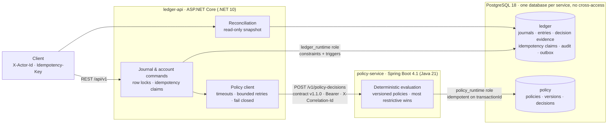
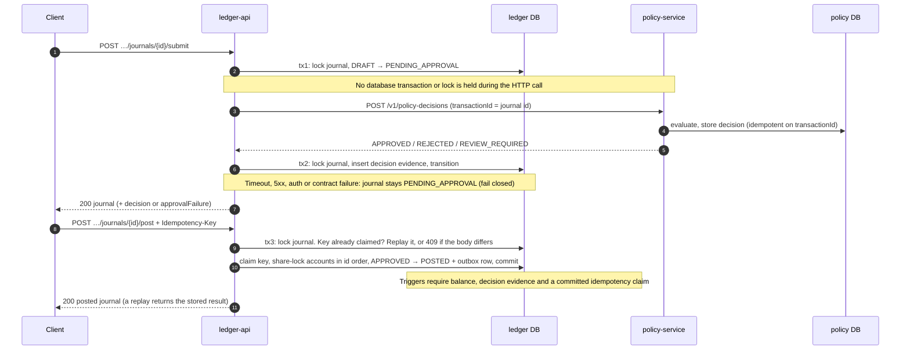

# LedgerCore

[](https://github.com/MurayaSoftTouch/LedgerCore/actions/workflows/ci.yml)

A double-entry financial ledger with a separate, versioned transaction-policy
service, built so that money movements stay correct under retries,
concurrency and partial failure.

## The problem

A ledger has to stay correct when things go wrong around it: clients retry
requests, two operators act on the same journal at once, the approval
service is slow or down, a response is lost after the other side committed,
or a bug in application code tries to write a state the business can't
have. LedgerCore treats each of those as a normal input with a defined
outcome, and enforces the financial rules in PostgreSQL as well as in code,
so a bug in one layer can't silently corrupt the books.

## Architecture



- **`services/ledger-api`** is the financial source of truth: ledgers,
  accounts, journals, posting, reversals and reconciliation. Balances are
  derived from posted entries; there is no balance table.
- **`services/policy-service`** decides `APPROVED` / `REJECTED` /
  `REVIEW_REQUIRED` from versioned, immutable policies.
- **`contracts/`** holds the OpenAPI 3.1 and JSON Schema contract between them,
  tested from both sides.
- **Outbox.** Each posting writes a `JournalPosted` row to `outbox_events` in
  the same transaction. No publisher reads it yet (see
  [limitations](#current-limitations)).

### Approval and posting



The full failure mapping, including the lost-response case, is in
[service integration](docs/architecture/service-integration.md#failure-mapping).

## Guarantees

- Every posted journal balances (**enforced**: domain model and PostgreSQL trigger).
- Posted history is immutable, and corrections use reversals (**enforced**:
  domain, database triggers, least-privilege runtime role).
- A policy decision that can't be trusted never approves anything (fail
  closed; ADR-005 and ADR-012, implemented in Milestone 3).
- Retries never double-post, and failures never leave partial state
  (**enforced**: posting is one locked transaction, and `post` / `reverse`
  require an `Idempotency-Key` whose claim the database requires; Milestone 4).

## Design decisions

| Decision | Why | Record |
| --- | --- | --- |
| Financial invariants in the database as well as the domain model | Constraints and triggers reject unbalanced, mutated or unapproved postings even if application code is wrong. A least-privilege runtime role can't disable them | [ADR-004](docs/adr/ADR-004-double-entry-immutable-posted-journals.md), [ADR-007](docs/adr/ADR-007-database-enforced-ledger-invariants.md) |
| Idempotency keys with request fingerprints | A retry with the same key and body replays the stored result; the same key with a different body is a `409`. The claim and the posting commit together | [ADR-015](docs/adr/ADR-015-idempotent-posting-and-reversal.md) |
| Explicit row locks at READ COMMITTED | Commands lock the journal `FOR UPDATE` before reading it and share-lock its accounts in sorted order, which avoids lock-order deadlocks and blocks account deactivation mid-posting | [ledger domain](docs/architecture/ledger-domain.md) |
| Fail-closed approvals | Any policy failure leaves the journal `PENDING_APPROVAL`; nothing is approved by default | [ADR-012](docs/adr/ADR-012-ledger-policy-reliability-contract.md) |
| Versioned, schema-tested service contract | Provider and consumer both test against the same OpenAPI/JSON Schema files, so contract drift fails CI | [ADR-005](docs/adr/ADR-005-versioned-ledger-policy-contract.md) |
| Deterministic, replayable policy decisions | Same input and policy version, same decision; decisions are stored once per transaction | [ADR-010](docs/adr/ADR-010-deterministic-policy-evaluation.md), [ADR-011](docs/adr/ADR-011-decision-persistence-and-replay.md) |
| Transactional outbox | The `JournalPosted` event is committed with the posting, so an event can never describe a posting that didn't happen | [ADR-014](docs/adr/ADR-014-transactional-outbox-foundation.md) |

All 16 records are indexed in [docs/adr](docs/adr/README.md).

## Trade-offs

- **Correctness over approval availability.** Failing closed means a policy
  outage stops approvals. The ledger stays ready and reports the policy
  service as degraded, but journals wait in `PENDING_APPROVAL` until it
  recovers.
- **Pessimistic locking over optimistic concurrency.** Explicit locks make
  conflicting commands queue rather than fail and retry. The cost is lock
  wait under contention on the same journal; there is no `SERIALIZABLE`
  isolation or row-version token.
- **Rules in two places.** Enforcing invariants in both the domain and
  PostgreSQL duplicates logic and makes schema changes heavier, in exchange
  for protection against bugs and direct writes by the runtime role.
- **No HTTP call inside a transaction.** Policy calls happen between two
  short transactions, so no lock is held across the network. The price is
  an intermediate `PENDING_APPROVAL` state and explicit handling of
  ambiguous outcomes (a decision committed but its response lost), which
  idempotent decisions make safe to retry.
- **Derived balances.** There is no balance table that could drift from the
  entries; balances are recomputed from posted entries, at the cost of
  computing them on read.

## Testing strategy

Over 400 test methods across both services (xUnit and JUnit 5, counting each
parameterized test once), run in CI on every pull request and push to `main`:

- **Domain unit tests** for money, accounts, double entry, lifecycle and reversals.
- **PostgreSQL integration tests (Testcontainers)** for database guards,
  idempotency, concurrent and conflicting commands, reconciliation, runtime-role
  privilege probes and log redaction.
- **Contract tests** on both sides of the ledger → policy boundary, against
  the shared JSON Schemas.
- **Multi-service tests** that build both images and put Toxiproxy between
  them to inject timeouts, resets and lost responses.
- **Compose smoke test** that approves and posts one journal end to end.

CI jobs: `ledger-api (.NET)`, `policy-service (Spring Boot)`, `contracts`,
`database isolation (roles)` and `integration (ledger + policy + PostgreSQL)`.
All are required to merge into `main`.

## Security model

- Service-to-service calls use shared bearer credentials (ADR-013); the
  policy management API has a separate credential and is disabled without one.
- Each service connects as a least-privilege runtime role; migration owners
  are separate credentials.
- Request sizes and JSON depth are bounded; errors never include exception
  text, SQL or echoed input; logs never include credentials or raw
  idempotency keys (tested).

Details and the reporting process are in [SECURITY.md](SECURITY.md).

## Current limitations

- **No outbox publisher.** `JournalPosted` events are written but not delivered.
- **No end-user authentication.** `X-Actor-Id` is client-asserted; the trust
  boundary is the network.
- **Shared secrets, not workload identity.** No mTLS; without TLS, service
  credentials cross the network in the clear.
- **No balance endpoint.** Balances are derived only in reconciliation and tests.
- **Reconciliation results are returned and logged, not stored.**
- **Database owners can still disable guard triggers.** Reconciliation detects
  the financial effect.
- **No metrics backend.** Observability is structured JSON logs, correlation
  ids, health endpoints and `/ops/outbox`.
- **Pre-release.** No tagged releases yet; Milestone 6 (release) is planned.

## Milestone history

**Milestone 5 (operational hardening).**
- Reconciliation reports categorized discrepancies with a run id and status, and tells legacy history from corruption.
- Readiness includes the schema, and dependency failures degrade predictably: a database outage is `503`, and a policy outage keeps the ledger ready.
- `/ops/outbox` shows how many events wait, and for how long.
- Requests, commands, policy calls and reconciliation runs are logged as structured JSON, with no secrets (proven by tests).
- Request sizes are bounded, and both runtime database roles pass destructive-privilege probes.
- A policy-service authentication bypass (path parameters) was found and fixed.

See [operational hardening](docs/architecture/operational-hardening.md), [ADR-016](docs/adr/ADR-016-operational-health-and-degradation.md) and the [Milestone 5 backlog](docs/backlog/milestone-5.md).

**Milestone 4 (posting hardening).**
- `post` and `reverse` are idempotent: a required `Idempotency-Key` header, and replays built from persisted state.
- Concurrent and conflicting requests are decided by PostgreSQL.
- Posting is bound in the database to its claim and to the journal's own `APPROVED` decision.
- The audit records the authorizing decision and the key.
- A reconciliation report recomputes the ledger from posted entries.

See [posting idempotency](docs/architecture/posting-idempotency.md), [ADR-015](docs/adr/ADR-015-idempotent-posting-and-reversal.md) and the [Milestone 4 backlog](docs/backlog/milestone-4.md).

**Milestone 3 (integration).** The ledger obtains every approval from the policy service. It uses a typed client with bounded retries, keeps journals `PENDING_APPROVAL` on any failure (fail closed), records each decision as append-only evidence that the database requires, and writes a `JournalPosted` outbox event with each posting. Service calls are authenticated with shared credentials, correlation ids span both services, and both run as least-privilege database roles. Docker Compose runs the whole stack. See [service integration](docs/architecture/service-integration.md) and the [Milestone 3 backlog](docs/backlog/milestone-3.md).

**Milestone 1 (ledger domain).** `ledger-api` implements ledgers, a chart of accounts, journals with double-entry validation, the ADR-006 lifecycle, transactional posting, and reversals, persisted in PostgreSQL with database-enforced invariants.

**Milestone 2 (policy engine).** `policy-service` implements versioned approval policies with four structured rule types, deterministic most-restrictive-wins evaluation, immutable and idempotent decision records, and contract v1 (now 1.1.0) on `POST /v1/policy-decisions`, persisted in its own PostgreSQL database. See [policy engine](docs/architecture/policy-engine.md), [ledger domain](docs/architecture/ledger-domain.md) and the [Milestone 1](docs/backlog/milestone-1.md) and [Milestone 2](docs/backlog/milestone-2.md) backlogs.

## Repository layout

```text
services/ledger-api/        ASP.NET Core solution: Domain + Api (src/), unit + PostgreSQL tests (tests/)
services/policy-service/    Spring Boot service (Maven wrapper)
tests/integration/          Multi-service tests (Testcontainers + Toxiproxy) and the Compose smoke script
contracts/                  OpenAPI + JSON Schemas + examples + validate.sh
infra/docker/postgres/      Database init and isolation check
docs/adr/                   Architecture decision records
docs/architecture/          Service boundaries, ledger domain, contributor ownership
docs/backlog/               Initial and per-milestone backlogs (not yet GitHub issues)
.github/                    CI, issue/PR templates, CODEOWNERS, label definitions
```

Contract tests live with each side: provider tests in `services/policy-service`, consumer tests in `services/ledger-api`. There is no separate `tests/contract` placeholder.

## Prerequisites

| Tool | Version used | Notes |
| --- | --- | --- |
| .NET SDK | 10.0.401 | pinned in `services/ledger-api/global.json` (rolls forward to later 10.0 feature bands); `dotnet-ef` via `dotnet tool restore` |
| JDK | 21 | Maven is supplied by `./mvnw` |
| Docker + Compose | 29.x / v5 | PostgreSQL; also required by `dotnet test` (Testcontainers) |
| Node.js | 20+ | only for `contracts/validate.sh` |

## Getting started

**Whole stack in Docker** (Milestone 3):

```bash
cp .env.example .env                        # local-only defaults, including service credentials
docker compose up -d --build --wait         # postgres, ledger-migrate, policy-service, ledger-api
./tests/integration/compose-smoke.sh        # approve and post one journal end to end
```

**Services on the host** (for development):

```bash
# 1. Database
cp .env.example .env                     # local-only defaults; .env is git-ignored
docker compose up -d --wait              # PostgreSQL 18 with databases `ledger` and `policy`
./infra/docker/postgres/verify-isolation.sh

# 2. Ledger API  → http://localhost:8080
set -a; source .env; set +a
cd services/ledger-api
dotnet tool restore
dotnet test                              # unit tests + PostgreSQL 18.6 via Testcontainers (Docker required)
# Migrations run as the schema owner (ledger_app), never as the runtime role:
dotnet ef database update --project src/LedgerCore.Ledger.Api \
  --connection "Host=localhost;Port=$POSTGRES_PORT;Database=ledger;Username=ledger_app;Password=$LEDGER_DB_PASSWORD"
# The API connects as the least-privilege runtime role:
export ConnectionStrings__Ledger="Host=localhost;Port=$POSTGRES_PORT;Database=ledger;Username=ledger_runtime;Password=$LEDGER_RUNTIME_DB_PASSWORD"
export Ledger__PolicyServiceToken="$POLICY_DECISION_API_TOKEN"   # the policy service's decision credential
dotnet run --project src/LedgerCore.Ledger.Api --launch-profile http

# 3. Policy service  → http://localhost:8081   (new terminal)
set -a; source .env; set +a                # POLICY_*_PASSWORD and POLICY_*_TOKEN; no committed defaults
cd services/policy-service
./mvnw verify                              # unit + PostgreSQL 18.6 Testcontainers tests (Docker required)
./mvnw spring-boot:run                     # Flyway migrates the `policy` database at startup

# 4. Contract, and the multi-service suite (builds both images; Docker required)
./contracts/validate.sh
(cd tests/integration && dotnet test)
```

The API never changes the schema at startup. If you created the Compose volume before Milestone 1, recreate it (`docker compose down -v`, which deletes local data) so the init script creates the `ledger_runtime` role.

Try it (the example uses `jq`):

```bash
H=(-H 'Content-Type: application/json' -H 'X-Actor-Id: you')
L=$(curl -s "${H[@]}" -d '{"code":"DEMO","name":"Demo"}' localhost:8080/api/v1/ledgers | jq -r .id)
curl -s "${H[@]}" -d '{"code":"1000","name":"Cash","type":"ASSET","currency":"KES"}' localhost:8080/api/v1/ledgers/$L/accounts
```

The full endpoint list is in [ledger-domain.md](docs/architecture/ledger-domain.md#http-api-milestone-1). Policy API: [policy-engine.md](docs/architecture/policy-engine.md#api). To try it: create a policy, add a version, activate it, then post `contracts/schemas/examples/request.valid.json` to `POST /v1/policy-decisions`.

### Endpoints

| | ledger-api | policy-service |
| --- | --- | --- |
| Liveness | `/health/live` | `/actuator/health/liveness` |
| Readiness | `/health/ready` (checks the ledger database) | `/actuator/health/readiness` |
| OpenAPI | `/openapi/v1.json` (Development) | `/openapi/v3/api-docs`, `/openapi/swagger-ui.html` |
| Info | — | `/actuator/info` (contract version) |
| Readiness includes | ledger database | policy database and schema (`readinessState,db,policySchema`) |
| Dependencies | `/health/dependencies`: policy service (`Degraded` when unreachable) | — |

### Configuration

Both services validate their configuration at startup and refuse to start if it's invalid.

| ledger-api (`Ledger:*`, env `Ledger__*`) | policy-service (`ledgercore.policy.*`) |
| --- | --- |
| `ConnectionStrings:Ledger`: required; the `ledger_runtime` role | |
| `ContractVersion`: semver, required | `contract-version`: semver, required |
| `PolicyServiceBaseUrl`: absolute URL, required | `environment`: required (`LEDGERCORE_ENVIRONMENT`, default `local`) |
| `PolicyServiceToken`: required, ≥ 32 characters (`Ledger__PolicyServiceToken`) | `POLICY_DB_URL` (default `jdbc:postgresql://localhost:5432/policy`); runtime `policy_runtime` / `POLICY_RUNTIME_DB_PASSWORD`; Flyway `policy_app` / `POLICY_DB_PASSWORD` |
| `PolicyAttemptTimeoutMs` (800), `PolicyMaxRetries` (2) | `POLICY_DECISION_API_TOKEN` (required), `POLICY_ADMIN_API_TOKEN` (empty disables the management API) |
| `PolicyDecisionTimeoutMs`: 100–30000, default 2000 | |
| `ExposeOpenApi`: `true` in Development | |

Logs are structured JSON on stdout: the JSON console formatter for .NET, and ECS for Spring (`LOG_FORMAT` overrides it).

## Formatting

```bash
(cd services/ledger-api && dotnet format)            # CI runs --verify-no-changes
(cd services/policy-service && ./mvnw spotless:apply)  # CI runs spotless:check
```

## Documentation

- [Service boundaries](docs/architecture/service-boundaries.md)
- [Ledger domain](docs/architecture/ledger-domain.md): model, lifecycle, posting, concurrency, immutability, reversals
- [Policy engine](docs/architecture/policy-engine.md): versions, rules, evaluation, decisions, idempotency, failure behaviour
- [Posting idempotency](docs/architecture/posting-idempotency.md): idempotency keys, concurrency, approval binding, reconciliation, failure injection
- [Operational hardening](docs/architecture/operational-hardening.md): health, degradation, reconciliation operations, outbox visibility, logging, security boundaries, troubleshooting
- [Service integration](docs/architecture/service-integration.md): approval sequence, retries, timeouts, failure mapping, evidence, authentication, correlation, outbox, health, Compose
- [Contributor ownership and milestones](docs/architecture/contributor-ownership.md)
- [ADRs](docs/adr/README.md): monorepo, ledger as source of truth, policy service, double entry and immutability, versioned contract, journal lifecycle, database-enforced invariants, money representation, immutable policy versions, deterministic evaluation, decision persistence and replay, ledger–policy reliability, service authentication, transactional outbox
- [Contract](contracts/README.md)
- [Contributing](CONTRIBUTING.md) · [Security](SECURITY.md)
